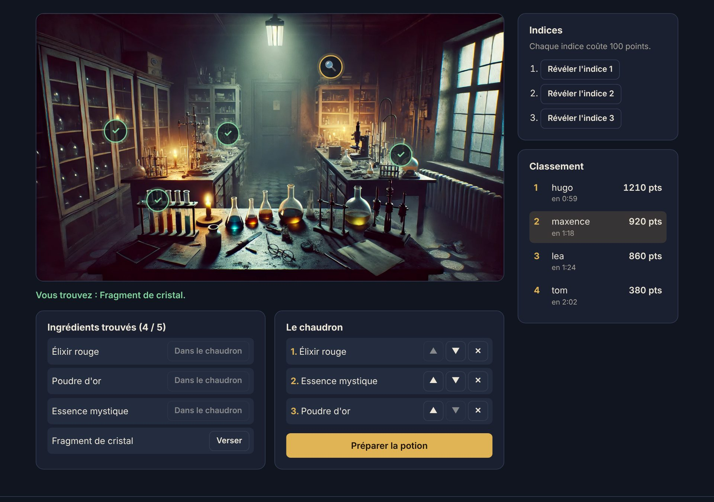
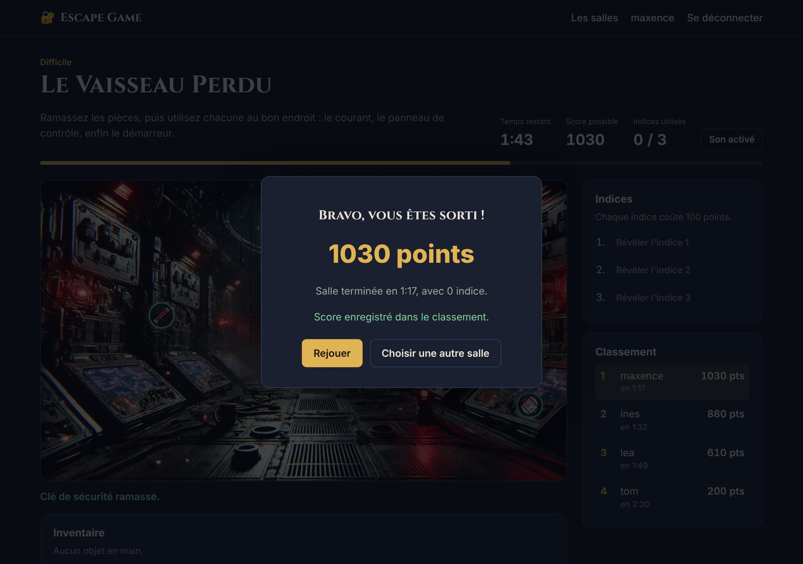

# Escape Game – Vue.js et PHP

Trois escape games chronométrés à jouer dans le navigateur : fouiller le décor, résoudre les énigmes et sortir avant la fin des trois minutes. Les joueurs inscrits entrent au classement de chaque salle et retrouvent l'historique de leurs parties. Le front-end est en Vue.js 3, l'API en PHP 8 avec PDO et une base MySQL ou MariaDB.

C'était le projet du module Technologies de l'internet, en licence professionnelle DLWM, rendu en février 2025. Je l'ai ensuite repris en entier : l'API faisait confiance à tout ce que le navigateur lui envoyait, score et identifiant du joueur compris.

La [démo](https://miscuitatlas.github.io/escape-game-vue-php/) est une version statique publiée sur GitHub Pages : les trois salles sont jouables, mais les comptes et le classement demandent le serveur PHP.


## Les salles

| Salle | Difficulté | Principe |
|---|---|---|
| La Bibliothèque Mystérieuse | Facile | Quatre objets cachent chacun une devinette. Une fois les quatre résolues, la porte s'ouvre. |
| Le Laboratoire Abandonné | Intermédiaire | Fouiller cinq cachettes, trouver les bons ingrédients et les verser dans le chaudron dans le bon ordre, d'après la note du chercheur. |
| Le Vaisseau Perdu | Difficile | Ramasser un fusible, une carte et une clé, les utiliser au bon endroit et répondre au code de sécurité de chaque système. |

Chaque salle dure 3 minutes. Le score vaut 10 points par seconde restante, moins 100 points par indice révélé.

## Fonctionnalités

- Jeu sans compte, ou avec un compte pour entrer au classement des dix meilleurs de chaque salle et garder l'historique de ses parties.
- Indices payants, chronomètre, musique et effets sonores désactivables.
- Réponses tolérantes : « L'Obscurité », « obscurite » et « le noir » sont acceptées.
- Jouable au clavier et sur téléphone.

<table>
  <tr>
    <td></td>
    <td></td>
  </tr>
</table>

**Stack** : Vue.js 3 (Composition API), Vue Router et Vite, PHP 8 avec PDO et sessions, MySQL 8 ou MariaDB, Vitest et ESLint.

## Ce que j'ai corrigé

- **Score et identité envoyés par le navigateur** : n'importe qui pouvait enregistrer n'importe quel score au nom de n'importe quel joueur, ou lire l'historique d'un autre en changeant `user_id` dans l'URL. Le joueur est maintenant lu dans la session, et le score recalculé par le serveur.
- **Prise de contrôle de compte** : la réinitialisation du mot de passe ne demandait que l'adresse email. Elle est remplacée par un changement de mot de passe qui exige le mot de passe actuel.
- **Fuite de mots de passe** : un fichier de débogage enregistrait les requêtes, mots de passe compris, et avait été publié. Il a été supprimé, y compris de l'historique du dépôt.
- **Erreurs trop bavardes et CORS ouvert** : les erreurs renvoyaient le détail des exceptions de la base de données, et plusieurs routes acceptaient toutes les origines.
- **Code recopié** : le chronomètre, les indices et le score étaient dupliqués dans les trois salles. Ils sont regroupés dans le composable `useEscapeGame`, et Vue CLI, qui n'est plus maintenu, est remplacé par Vite.

## Sécurité

- Mots de passe hachés avec bcrypt. Pour un email inconnu, le serveur vérifie quand même un hachage factice, pour que le temps de réponse ne révèle pas quels comptes existent.
- Requêtes préparées partout, cookie de session `HttpOnly` et `SameSite=Lax`, identifiant de session régénéré à la connexion.
- L'API n'accepte que des requêtes JSON : un formulaire envoyé depuis un autre site est refusé, ce qui protège du CSRF.
- Erreurs génériques côté client, avec le détail dans le journal du serveur.

## Installation

Prérequis : Node.js 20.19 ou plus récent, PHP 8.1 ou plus récent avec les extensions `pdo_mysql` et `mbstring`, et un serveur MySQL ou MariaDB.

```bash
git clone https://github.com/MiscuitAtlas/escape-game-vue-php.git
cd escape-game-vue-php
npm install
mysql -u root -p -e "CREATE DATABASE escape_game CHARACTER SET utf8mb4 COLLATE utf8mb4_unicode_ci"
mysql -u root -p escape_game < database/schema.sql
cp api/config.example.php api/config.php     # puis renseigner l'accès à la base
```

Puis, dans deux terminaux à la racine du projet :

```bash
php -S localhost:8000      # API PHP
npm run dev                # application sur http://localhost:5173
```

En développement, Vite redirige les appels `/api` vers le serveur PHP, sans configuration CORS. `npm run build:demo` génère la version statique, sans API.

## Tests

```bash
npm test          # tests unitaires : réponses, score, client de l'API
npm run lint      # ESLint
API_TEST_URL=http://localhost:8000/api npm run test:api
```

Les 20 tests unitaires tournent sans serveur. Les 17 tests de l'API envoient de vraies requêtes au serveur PHP et créent des comptes, il faut donc une base de test. Ils vérifient que le score est recalculé par le serveur, qu'un joueur ne voit que son propre historique et qu'aucune erreur ne divulgue de détail technique.

## Structure

```
api/                    une route PHP par fichier, lib/bootstrap.php pour la connexion, la session et la validation
database/               schéma de la base et migration depuis la première version
src/composables/        useEscapeGame : chronomètre, indices, score et sauvegarde communs aux trois salles
src/views/games/        les trois salles
tests/                  tests unitaires, et tests de l'API dans tests/api/
```

## Limites

- Le jeu se déroule dans le navigateur : un joueur peut appeler l'API directement et déclarer un temps restant flatteur, dans la limite de 180 secondes. Pour l'empêcher, il faudrait que le serveur chronomètre lui-même la partie, avec un jeton délivré à l'entrée dans la salle.
- La démo sur GitHub Pages n'a ni comptes ni classement.

## Ce que j'ai appris

- **Tout ce qui vient du navigateur peut être modifié** : l'identifiant du joueur, le score, le `localStorage`. Lire le joueur dans la session et recalculer le score côté serveur règle l'essentiel, mais pas tout (voir les limites).
- **Le temps de réponse peut trahir des informations** : sans hachage factice, un email inconnu répond plus vite qu'un mauvais mot de passe, ce qui permet de deviner quels comptes existent.
- **Factoriser avant de corriger** : une fois la mécanique des salles regroupée dans un composable, chaque correction ne se fait plus qu'une fois au lieu de trois.

## Auteur

Projet réalisé lors du module Technologies de l'internet, en licence professionnelle Développement Logiciel et Web Mobile (DLWM), puis retravaillé.

**Maxence Français** : [portfolio](https://miscuitatlas.github.io) · [LinkedIn](https://www.linkedin.com/in/maxence-fran%C3%A7ais-a039a2307/)
